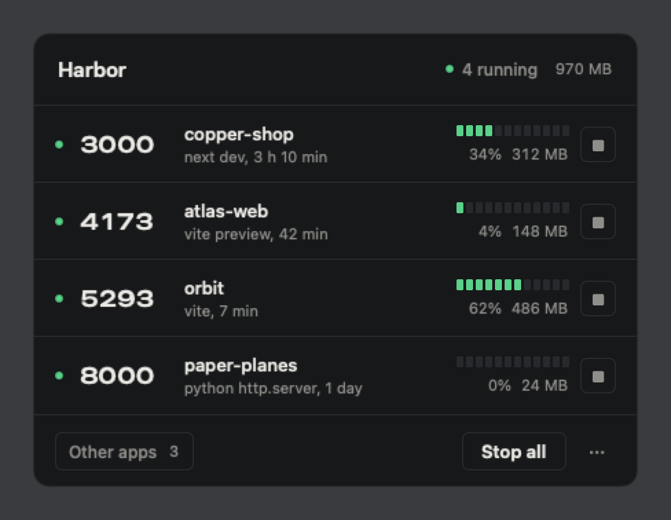

# Harbor

See every dev server on your Mac and stop it with a click.

<p align="center"></p>

<p align="center">    </p>

Requires macOS 15 or later.

## What it does
- Lists every listening port with project, tool and uptime.
- Live CPU strip and memory for each server.
- Stop names the tool and every port it will free, and asks on the row first. It sends SIGTERM; Force quit appears if it ignores it. Stop only acts on the same process it was shown, never on a reused PID.
- Copy the URL, open it in the browser, or reveal the folder. Databases get Copy address instead of Open in browser.
- Shows the git branch of each server, and marks linked worktrees, so you can tell which worktree runs on which port.
- Docker containers with published ports are listed by name and image, and Stop stops the container. A Settings switch turns this off.
- Marks idle servers. Time asleep doesn't count as idle.
- A notification when a port is taken, with a Stop button for the process holding it (Settings switch).

## Keyboard
| Action | Shortcut |
|---|---|
| Open Harbor | ⌥⌘H |
| Close a pending Stop question, then the panel | Esc |

## Install

**Homebrew**

```
brew tap noterikkirillov8/tap
brew trust noterikkirillov8/tap
brew install --cask harbor
```

**Download**: get `Harbor-1.0.0.zip` from [Releases](https://github.com/noterikkirillov8/harbor/releases), unzip it and drag `Harbor.app` to Applications.

**Build from source**: see below.

Harbor isn't notarised by Apple (that needs a paid developer account), so the first time macOS may say it can't verify the developer: open System Settings → Privacy & Security, scroll down and click Open Anyway (on macOS 15 and later right-click → Open no longer works). The Homebrew cask clears that flag for you.

## How it works
Harbor lists your user's listening TCP sockets with libproc (no `lsof`, no shelling out), then reads each process's path, working directory and arguments to name the project and tool. Dev servers come first; other apps are collapsed and Apple system processes are hidden. For the branch, Harbor runs `lsof` and `git` on a server's working directory with a one-second limit. For Docker containers it runs the `docker` CLI against the local Docker or OrbStack socket if one exists.

## Privacy
No network, no telemetry. Harbor reads local process information and talks to Docker only through its local socket. The only permission it asks for is notifications, for the port-taken alert.

## Build from source
Needs Xcode 16+ and [XcodeGen](https://github.com/yonaskolb/XcodeGen).

```
scripts/test.sh                  # tests
NO_OPEN=1 scripts/install.sh      # build Release and install to /Applications
```
`scripts/install.sh` signs with the author's local certificate if you have it, and ad hoc otherwise, so it works on any Mac.

## Credits
MIT licence. Interface sounds by Kenney (kenney.nl), CC0.

---
Part of Patchbay: [Harbor](https://github.com/noterikkirillov8/harbor) / [Tally](https://github.com/noterikkirillov8/tally) / [Sweep](https://github.com/noterikkirillov8/sweep) / [Ledge](https://github.com/noterikkirillov8/ledge) / [Switchboard](https://github.com/noterikkirillov8/switchboard) / [Shutter](https://github.com/noterikkirillov8/shutter) / [Reel](https://github.com/noterikkirillov8/reel) / [Vigil](https://github.com/noterikkirillov8/vigil)
